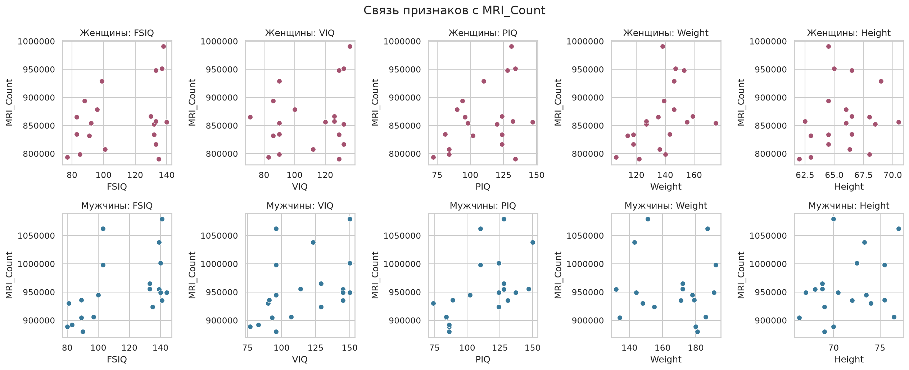
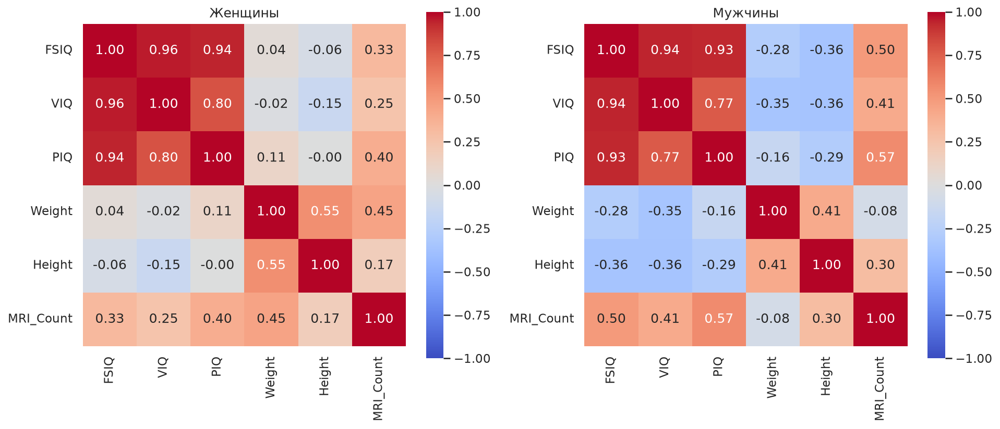

# Лабораторная работа №2. Pandas и корреляционный анализ

В этой работе я разобрал два набора данных: пассажиров Titanic и таблицу brainsize.
Для Titanic посчитал пропуски и показатели по классам. Для brainsize сравнил
корреляции с `MRI_Count` отдельно у мужчин и женщин.

Решения находятся в `pandas_tasks.py` и `correlation_tasks.py`.
Ноутбук нужно запускать из папки лабораторной, рядом с файлами данных.

## 1. Titanic

Возраст оставил с пропусками. При подсчёте среднего Pandas пропускает `NaN`,
поэтому заменять его нулём не нужно. Долю выживших можно получить как среднее
столбца `Survived`, потому что в нём стоят 0 и 1.

В таблице 891 пассажир, из них 305 старше 30 лет. Больше всего пропусков в
`Cabin` — 687. В `Age` не хватает 177 значений, а в `Embarked` — двух.

Средний возраст уменьшается от первого класса к третьему: 38,23; 29,88 и 25,14 года.
Доля выживших тоже выше в первом классе: 62,96% против 47,28% во втором и 24,24%
в третьем. По этим данным видно различие между классами, но одного такого
сравнения недостаточно, чтобы объяснить все причины выживания.

В списке тарифов есть повторы: задание просит пять наибольших значений,
а не пять разных тарифов.

## 2. Корреляционный анализ

Таблица разделена табуляцией, а пропуски обозначены `NA`. Разделил данные по полу,
чтобы посчитать коэффициенты отдельно. Корреляция считается по парам, где оба
значения известны: строки с пропуском веса не нужно удалять из остальных расчётов.

### Диаграммы рассеяния

Каждая точка — одно наблюдение. Сравнил все пять признаков с `MRI_Count`,
для каждой группы построил свой ряд графиков.

### Тепловые карты

На heatmap показал корреляции всех выбранных числовых признаков. Шкала одинакова
для двух групп: от −1 до 1, поэтому цвета можно сравнивать.

## Выводы

В каждой группе по 20 человек. Самая большая по модулю корреляция с `MRI_Count`
получилась у `PIQ` среди мужчин: примерно 0,568. Это умеренная положительная связь:
при большем `PIQ` значения `MRI_Count` в этой выборке в среднем выше.

У женщин сильнее всего связан с `MRI_Count` вес — примерно 0,446. У мужчин связь
веса с `MRI_Count` почти отсутствует: около −0,077. Значит, результаты двух групп
действительно отличаются, и раздельный расчёт здесь полезен.

На графиках точки заметно разбросаны. Выборка небольшая, поэтому делать широкие
выводы по ней я бы не стал. Также корреляция сама по себе не доказывает, что один
признак влияет на другой.

В итоге я потренировался читать таблицы, находить пропуски, использовать `groupby`
и считать корреляции. Важный момент — не подставлять нули вместо неизвестных
значений: это может изменить и средний возраст, и коэффициенты корреляции.